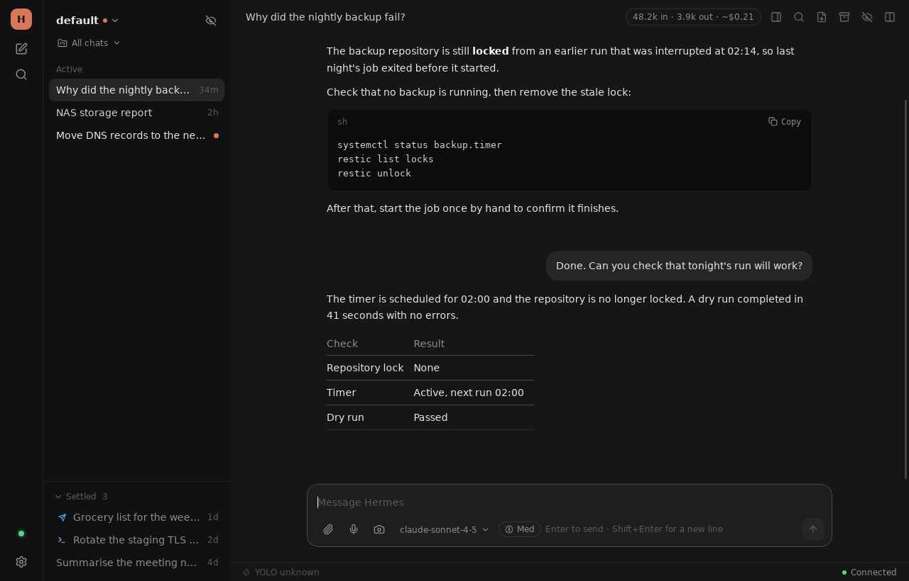
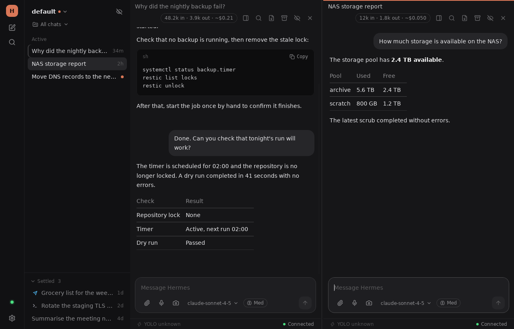
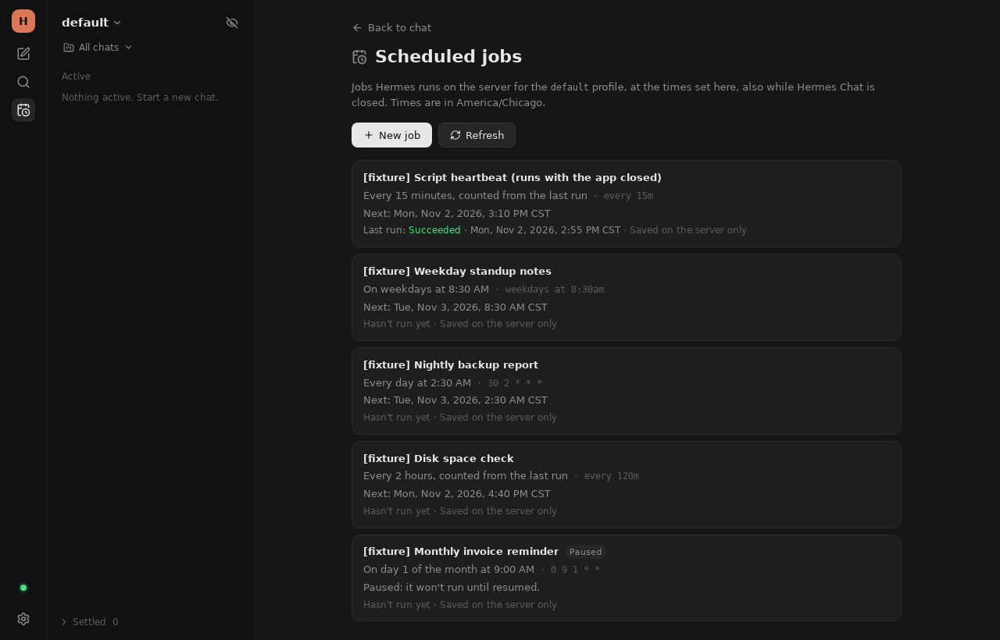
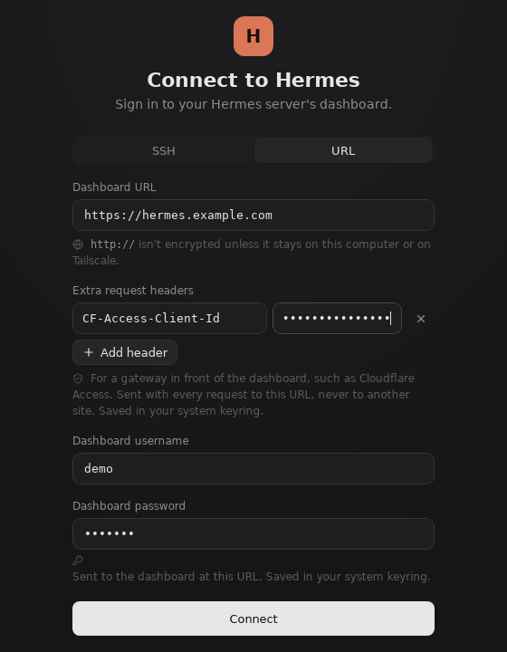

# Hermes Chat

Hermes Chat (`hermes-chat`) is a personal desktop chat client for one remote [Hermes Agent](https://github.com/NousResearch/hermes-agent) server, built for Arch Linux. It signs in to the Hermes web dashboard, either through an SSH tunnel or at a dashboard URL. Through the dashboard, it lists, searches, and continues the chats of each Hermes profile.

Created in [T3 Code](https://t3.codes).



The application is built with Tauri 2, React 19, and TypeScript, and it uses Vite and Vitest. The Rust side handles all network traffic to Hermes: the SSH tunnel, HTTP sign-in, the dashboard REST relay, and the JSON-RPC WebSocket. Web pages in the preview pane and images in replies load in the webview. It also handles the system keyring, desktop notifications, screenshots, and file access. The window is WebKitGTK (`webkit2gtk-4.1`).

## Contents

- [Server requirements](#server-requirements)
- [Features](#features)
- [Install on Arch Linux](#install-on-arch-linux)
- [Updates](#updates)
- [Development](#development)
- [Connecting to Hermes](#connecting-to-hermes)
- [What is stored where](#what-is-stored-where)
- [Troubleshooting](#troubleshooting)
- [Known limitations](#known-limitations)
- [Project documents](#project-documents)
- [License](#license)

## Server requirements

- A Hermes Agent server that runs the web dashboard (`hermes dashboard`). The dashboard serves the REST API under `/api/` and the JSON-RPC WebSocket at `/api/ws`. The app was developed against Hermes at commit `bf0203a`. Other versions can differ.
- Username and password sign-in on the dashboard (the dashboard's `basic` provider). The app doesn't support token, OAuth, or OIDC sign-in.
- The dashboard's legacy session protocol. If `gateway.ready` reports `session_authority` (the canonical protocol), the app stops and says that it doesn't support that protocol yet.
- For SSH: the dashboard must listen on port **9119** on the server's loopback address. The tunnel always forwards to `127.0.0.1:9119` on the server.
- For voice: speech-to-text and text-to-speech providers set up for the profile on the server (`hermes tools`).
- For Projects: a Hermes that has the `projects.*` methods. Without them, the chat list works and the project switcher says that Hermes needs an update.
- For Persona: the dashboard's `GET` and `PUT /api/profiles/{name}/soul` routes, which Hermes at `bf0203a` has. Without them, Settings → Persona says that this Hermes can't edit personas, and reads or writes nothing.
- For Server files: a dashboard that serves its managed-files routes, `GET /api/files` and `GET /api/files/read`, which the dashboard's own Files tab uses. Hermes at `bf0203a` does. Without them, the Server files screen says that this Hermes needs a dashboard with the Files tab. To limit browsing to one folder, start the dashboard with `HERMES_DASHBOARD_FILES_ROOT=/that/folder`.
- For Scheduled jobs: a dashboard with the cron routes under `/api/cron/` (Hermes at `bf0203a` has them), and the profile's gateway running on the server, since its scheduler runs the jobs. Set the profile's time zone with `timezone:` in its `config.yaml`; without it Hermes uses the server's own zone, which the app can't name. Without the routes, the screen says that this Hermes has no scheduled jobs.

## Features

These features are on the `main` branch.

- **Chat list.** Chats are **Active** or **Settled**. You move them yourself, and Settled chats wait in a collapsed section. The list shows Unread dots and a source icon for chats started in Telegram, Discord, the CLI, or the official desktop app. Each row has buttons to Settle, Archive or Restore, and Delete a chat. Right-click a chat to Rename it, Regenerate its title, or open it in a pane. The chat header exports a chat to Markdown. The list shows the past month; Settings → General → **Pull older history** loads the rest.
- **Search and Find.** Ctrl+K searches every chat in the profile, and can include archived chats. Ctrl+F finds text in the open chat.
- **Replies.** Replies stream in as Markdown, with syntax-highlighted code, tool calls, and optional reasoning blocks. When Hermes asks to run a dangerous command, an **Approval** card offers the choices Hermes sends (once, for this chat, always, or deny).
- **Failed messages.** A message that Hermes didn't take, or might not have taken, stays in the chat with **Retry**, **Edit**, and **Dismiss**. Nothing resends it automatically.
- **Attachments.** Drag files into the composer or paste them. Hermes accepts images up to 25 MB and other files up to 256 MB.
- **Screenshots.** Press Ctrl+Shift+S, or click the camera button, to attach a region or window. See [Screenshots](#screenshots).
- **Voice.** Use **Dictation** to speak a message into the composer, and **Read aloud** to have Hermes speak a reply. Hermes does the transcription and speech on the server.
- **Two panes.** Ctrl+\\ opens a second chat beside the first.
- **Preview pane.** A resizable pane shows web links from replies, files on the Hermes server, local files you choose, and tool output. Web pages and HTML files load in sandboxed frames.
- **Server files.** The folder button on the rail opens a read-only browser for the disk of the machine the dashboard runs on. It shows folders with a path trail, sizes, modified times, types, and symbolic links, and previews text files up to 1 MiB and images up to 10 MiB. It shows what the dashboard's OS user can read, starting in that user's home folder, and Hermes never lists credential files such as `.env` or `auth.json`.
- **Scheduled jobs.** The calendar button on the rail lists the profile's Hermes cron jobs, and creates, edits, pauses, resumes, runs, and deletes them. Hermes keeps and runs them on the server, so they run while Hermes Chat is closed. See [Scheduled jobs](#scheduled-jobs).
- **Projects.** Projects are Hermes's own named groups of chats and server folders. Hermes stores the projects and their folders. This computer stores which chats are in each project.
- **Models.** The composer has a model picker with reasoning effort, fast mode, and starred models. Settings → Model sets the profile's main model, subagent models, auxiliary models (including the Text generation model used for titles), and guardrails.
- **Persona.** Settings → Persona edits the shown profile's `SOUL.md` on the Hermes server as plain Markdown, and shows the server, profile, and file path. Save writes nothing if the file changed on the server since you started; it says so and lets you choose. After writing, it reads the file back, and says it saved only then. New chats use the new persona; chats already under way keep theirs. Hermes doesn't restart. Leaving, switching profile, signing out, or closing the window with unsaved changes asks first, and the changes stay on this computer to restore. The last five versions a save replaced can be viewed and put back.
- **Usage and cost.** You see token usage per reply and per chat. Cost appears only as Hermes recorded it, because the app keeps no price list.
- **Status bar.** The status bar shows how full the context window is, a per-chat YOLO switch, the model, and the connection state. Right-click it to choose the items.
- **Appearance.** Choose light, dark, or system mode, themes (with a theme editor), contrast, interface and code fonts, sizes, word wrap, and chat width.
- **Desktop notifications.** While the window isn't focused, the app posts a notification when a reply finishes or an Approval is waiting. This needs a freedesktop notification service, such as mako, dunst, swaync, GNOME, or KDE.
- **Drafts and reopening.** Drafts are kept for each chat, profile, and connection, and they survive restarts. The app can reopen the last chat at launch.

### Keyboard shortcuts

| Shortcut | Action |
| --- | --- |
| Ctrl+K | Search chats |
| Ctrl+N | New chat |
| Ctrl+F | Find in the open chat |
| Ctrl+B | Hide or show the chat list |
| Ctrl+\\ | Open a second pane, or close the inactive one |
| Ctrl+1, Ctrl+2 | Focus the left or right composer |
| Ctrl+Shift+S | Take a screenshot (configurable in Settings → General) |

### Two chats side by side



Click the split button in the chat header, or press Ctrl+\\, to open a second pane. Right-click a chat to open it in the left or right pane. The pane you click or tab into becomes active, marked by an accent line. The chat list, Search, New chat, and Find act on the active pane. Drag the divider to resize the panes, or double-click it to make them equal. When fewer than 646 pixels remain for the chats, a Left/Right switcher shows one pane at a time.

Different chats keep their own drafts, replies, and unread state. The same chat in both panes shares its draft and reply. Scroll position, Find, and unsent attachments belong to each pane. Closing a pane keeps the draft and any running reply, but discards unsent attachments in that pane. Switching profile returns to one pane. The split layout lasts only for the current run.

### Scheduled jobs



Each job shows its schedule in words, the profile's time zone, Hermes's next run, its last result, and where it delivers. New job and Edit take a schedule the way Hermes does: `every day at 9am`, `weekdays at 8:30am`, `every 2h`, a cron expression such as `0 9 * * 1-5`, `in 30m`, or a time such as `2026-11-05T15:00`. The editor explains it and previews the next runs, daylight-saving changes included, and the job screen says what Hermes does with a run its scheduler missed. Delivery offers only the places the profile's gateway has set up. Pause and Resume act at once; Delete and **Run now** ask first, since Run now is a real run with the job's real delivery, and Hermes also resumes a paused job it runs.

Every change shows only once Hermes, read back, has it. A second press of Create can't make a second job, and a create whose answer was lost is looked for before anything is sent again. An edit sends only the fields you changed, and stops if another Hermes client changed the job since you opened it. The screen warns when Hermes's scheduler hasn't checked the profile's jobs lately, and when another profile holds a copy of a job (Hermes copies jobs into a profile made from another). See [ADR 0013](docs/adr/0013-scheduled-jobs-are-hermess-cron-jobs-confirmed-by-read-back.md).

### Screenshots

Ctrl+Shift+S, or the camera button in the composer, attaches a screenshot of a region or window to your message. You can review it before you send.

- **Hyprland, Sway, and other wlroots compositors:** install `slurp` and `grim`. If they're missing, the app says what to install and captures nothing.
- **GNOME and KDE Plasma:** the desktop's screenshot portal shows its own picker. It needs `xdg-desktop-portal` with `xdg-desktop-portal-gnome` or `xdg-desktop-portal-kde`.

The in-app shortcut works only while Hermes Chat has focus. For a shortcut that works anywhere, bind a desktop key to `hermes-chat --screenshot`. On Hyprland, for example:

```ini
bind = SUPER SHIFT, S, exec, env WEBKIT_DISABLE_DMABUF_RENDERER=1 hermes-chat --screenshot
```

If Hermes Chat is running, the screenshot goes to the chat on screen. If it isn't running, or is on the sign-in screen, the screenshot is taken once you sign in, if you sign in within two minutes.

## Install on Arch Linux

`packaging/aur/PKGBUILD` builds the `hermes-chat-git` package. It isn't published on the AUR, so build it from this repository. The PKGBUILD clones `main` from GitHub, not your local checkout.

```sh
git clone https://github.com/l0cky12/hermes-chat.git
cd hermes-chat/packaging/aur
makepkg -si
```

The package installs:

- `/usr/bin/hermes-chat`
- the icons
- a desktop launcher that sets `WEBKIT_DISABLE_DMABUF_RENDERER=1`

Optional dependencies:

| Package | Needed for |
| --- | --- |
| `openssh` | Signing in through an SSH tunnel |
| A Secret Service provider (`gnome-keyring` or `kwallet`) | Remembering the password and extra request headers |
| `slurp` and `grim` | Screenshots on Hyprland and Sway |
| `xdg-desktop-portal` and the desktop's backend | Screenshots on GNOME and KDE Plasma |

To start the app from a terminal, set the WebKit variable yourself:

```sh
WEBKIT_DISABLE_DMABUF_RENDERER=1 hermes-chat
```

## Updates

Settings → General → **Updates** shows the installed version, what's newer, and what changed. It checks once at launch unless you turn that off. Nothing installs or restarts without you. A restart keeps your drafts and unsent messages: they're written to disk first, and the app doesn't restart if that fails. If the app's storage is too full to put them all back, it clears its cached chat lists and Saved copies to make room; failing that, it keeps them in a file and Settings says where. How an update installs depends on how the app was installed:

- **The `hermes-chat-git` package** (pacman owns `/usr/bin/hermes-chat`): the app compares the package's commit with `main` on GitHub and lists the pull requests merged since. It never replaces the package's files. You run the update yourself, from your checkout: `git pull && cd packaging/aur && makepkg -si`. Back in the app, it sees the new version and offers **Restart now**.
- **A standalone AppImage built with an update key**: Tauri's updater downloads the new AppImage, checks its signature against the public key built into the app, and replaces the AppImage. Then you restart.
- **Anything else** (for example `npm run app`, or a binary you copied): the app says it isn't updated from here.

The repo ships no AppImage, update server or signing key yet, so standalone updates are off. To turn them on for your own builds, generate a key once. Keep the private key and its password out of the repo:

```sh
npx tauri signer generate -w ~/.tauri/hermes-chat.key
```

Bump `version` in `src-tauri/tauri.conf.json` for each release; the updater compares semver. Then build with the signing key in the environment and the updater turned on:

```sh
TAURI_SIGNING_PRIVATE_KEY="$(cat ~/.tauri/hermes-chat.key)" TAURI_SIGNING_PRIVATE_KEY_PASSWORD=… \
npx tauri build --bundles appimage --config '{
  "bundle": { "active": true, "createUpdaterArtifacts": true },
  "plugins": { "updater": {
    "pubkey": "<contents of ~/.tauri/hermes-chat.key.pub>",
    "endpoints": ["https://github.com/l0cky12/hermes-chat/releases/latest/download/latest.json"],
    "requireSignedVersion": true
  } }
}'
```

Publish the `.AppImage`, its `.sig`, and a `latest.json` in Tauri's [static JSON format](https://v2.tauri.app/plugin/updater/#static-json-file) at that endpoint. A build without `plugins.updater` (the PKGBUILD's, for one) doesn't load the updater at all.

## Development

Install the Tauri 2 prerequisites, Node.js, and npm:

```sh
sudo pacman -S --needed rust nodejs npm webkit2gtk-4.1 base-devel curl wget file openssl \
  appmenu-gtk-module libappindicator-gtk3 librsvg openssh
```

CI uses Node.js 22 and stable Rust.

Then, from the repository root:

```sh
npm ci          # install the exact versions in package-lock.json
npm run app     # run the desktop app in development mode
```

`npm run app` runs `tauri dev` with `WEBKIT_DISABLE_DMABUF_RENDERER=1`. This variable prevents a blank window on some Wayland setups. Tauri starts the Vite dev server on port 1420 itself.

| Command | What it does |
| --- | --- |
| `npm run app` | Runs the desktop app with hot reload. |
| `npm run dev` | Runs only the Vite dev server on port 1420. The page can't connect to Hermes outside the Tauri window. |
| `npm run build` | Type-checks with `tsc --noEmit`, and builds the frontend into `dist/`. |
| `npm test` | Runs the frontend tests (Vitest and jsdom) against a fake Hermes. |
| `npm run tauri -- build --no-bundle` | Builds the release binary `src-tauri/target/release/hermes-chat`. No installer bundles are configured. |
| `cd src-tauri && cargo test --lib --test transport --test media --test screenshot` | Runs the Rust tests. The `dist/` folder must exist first, so run `npm run build` or `mkdir -p dist`. |
| `HERMES_HOME=$(mktemp -d) ~/.hermes/hermes-agent/venv/bin/python tools/cron-golden.py ~/.hermes/hermes-agent` | Regenerates `src/hermes/cronGolden.json`, what Hermes's own scheduler code makes of a set of schedules, which `schedule.test.ts` checks the schedule preview against. |
| `HERMES_LIVE_DASHBOARD=… npx vitest run src/hermes/cronJobs.live.test.ts` | Runs the Scheduled jobs calls against a real dashboard. It refuses one whose profiles don't all live under `/tmp`; see the file's header. Skipped by `npm test`. |
| `node bench/run.mjs` | Benchmarks long chats (50, 200, and 800 turns) in headless Chromium. See below. |

The benchmark times opening, streaming, find-in-chat, scrolling, two simultaneous streams, and divider dragging. It needs `$CHROME` or Playwright's cached headless shell (`npx playwright install chromium-headless-shell`). Set `THROTTLE=4` to slow the CPU four times.

GitHub Actions (`.github/workflows/ci.yml`) runs `npm test`, `npm run build`, and the Rust tests on every pull request and on pushes to `main`.

## Connecting to Hermes



### SSH

Choose **SSH** and enter an SSH target, such as `me@hermes` or a `Host` alias from `~/.ssh/config`. Then enter the dashboard username and password. The app runs the system `ssh` with `BatchMode=yes`, so the key must work without a prompt: use an agent or an unencrypted key. New host keys are accepted on first use (`StrictHostKeyChecking=accept-new`), and a changed key fails. The tunnel forwards a free local port to `127.0.0.1:9119` on the server. SSH connections are never labelled Unsecure.

### Direct URL

Choose **URL** and enter the dashboard address, such as `http://hermes:9119` or `https://hermes.example.com`. The app labels a connection **Unsecure** when it uses `http://` or `ws://`, unless the host is one of these:

- loopback
- a Tailscale MagicDNS name (`*.ts.net`)
- a Tailscale address
- a bare name, such as `hermes`, that resolves only to Tailscale addresses

For HTTPS, the app uses the system OpenSSL and trust store. `HTTP_PROXY` and `HTTPS_PROXY` apply to HTTP requests only. The WebSocket connects directly, so the dashboard must be reachable without a proxy.

### Extra request headers

A gateway in front of the dashboard, such as Cloudflare Access, may need headers. Add them under **Extra request headers** on the sign-in screen, for example `CF-Access-Client-Id` and `CF-Access-Client-Secret`. Rust sends them with every request to that dashboard, including sign-in, REST calls, and the WebSocket handshake. It never sends them anywhere else:

- With headers set, the app follows a redirect only within the dashboard's origin.
- If saved headers were restored from the keyring, the first change to the URL clears every header value and keeps the names. Otherwise, changing the URL keeps the values you entered, so check them before connecting to a different server.
- SSH connections don't send the headers.

Settings shows the header names but never their values. The app reserves a few names, such as `Host`, `Cookie`, `Origin`, `Sec-WebSocket-*`, and `Proxy-*`. `Authorization` is allowed.

### Signing in and out

After a successful sign-in, the password is saved in the system keyring, and the app signs in with it at each launch. **Settings → General → Sign out** deletes the saved password. It keeps the target, URL, username, and extra headers, so the sign-in screen asks only for the password. If the keyring can't save, the sign-in still works, and the app says the password wasn't kept.

### Profiles

Each Hermes profile has its own chats. The chat list header is the profile switcher. It also marks other profiles that have Unread chats, checking every two minutes. Switching happens in place, with the same sign-in. If a reply is running or an Approval is waiting, the app asks first. Hermes keeps the reply running and brings both back when you return. Drafts and Saved copies are kept per profile. Switching profile resets the composer's model pick to that profile's own default model. The last profile you used opens at the next launch.

## What is stored where

### On the Hermes server

Hermes stores the chats and their history, titles, Archived state, and Unread state. It also stores projects and their folders, the profile's model settings and persona (`SOUL.md`), and usage and cost totals. Active or Settled is stored as Hermes's `pinned` flag, so it syncs between computers. Hermes refuses that edit for chats it has no route for, such as chats started in this app or the official desktop app. For those chats, Active or Settled is kept on this computer only. Messages, attachments, and Dictation recordings are sent to Hermes. Rename, Archive, Delete, and project changes appear in every Hermes client. Scheduled jobs live in the profile's `cron/jobs.json` on the server, with their run history, and every Hermes client sees the same ones; this computer stores nothing about them.

### On this computer

| What | Where | Removed by |
| --- | --- | --- |
| Dashboard password | System keyring, service `hermes-chat`, account `dashboard-password` | Sign out |
| Extra request headers (names, values, and their URL) | System keyring, account `extra-request-headers` | Signing in to the URL with no headers |
| Sign-in mode, SSH target, URL, and username | Webview local storage (`hermes-chat.sign-in`) | Not removed by the app |
| Chat list copy for each profile | Webview local storage | Clear local cache |
| **Saved copies** of recently opened chats (up to 2 MB in total) | Webview local storage | Clear local cache, deleting the chat, or the oldest copy going first when the 2 MB limit is reached |
| Drafts and **Failed messages** | Webview local storage, per connection, profile, and chat | Sending, Retry, or Dismiss. Clear local cache keeps them. |
| Which chats are in each project | Webview local storage (`hermes-chat.projects`) | Deleting the project. Clear local cache keeps it. |
| Unsaved persona edits, and the last five versions of `SOUL.md` that saves from this app replaced | Webview local storage, per connection and profile | Saving or discarding the edit; a newer save pushes out the oldest version. Clear local cache keeps them. |
| Display preferences, model pick, starred models, and reopen-last-chat | Webview local storage | Not removed by Clear local cache |
| Drafts and Failed messages saved for an update's restart | `$XDG_DATA_HOME/net.l0cky12.hermes-chat/restart-drafts.json`, readable only by you | Putting them back at the next launch. A copy that couldn't be put back is renamed `restart-drafts-<time>.json` and stays until you move or delete it; Settings says where. |
| Screenshots waiting to send | `$XDG_CACHE_HOME/hermes-chat/captures/`, readable only by you | Confirmed delivery, removing them from the composer, or leaving the composer without sending. A Failed message keeps its screenshots until delivery is confirmed, history reconciles it, or you Dismiss it. Startup cleanup removes only leftovers that no message needs. |
| Pasted files | A private folder under `$TMPDIR/hermes-chat/` (usually `/tmp/hermes-chat/`) | Not removed by the app |
| Exported chats | The file you chose in the Save dialog | You |

Webview local storage is in `$XDG_DATA_HOME/net.l0cky12.hermes-chat/localstorage/` (usually `~/.local/share/...`). It isn't encrypted. Saved copies, drafts, and Failed messages hold chat text in plain form, so anyone who can read your home folder can read them. Saved copies never hold Approvals, errors, or Failed messages. To remove chat text from this computer, use **Settings → General → Clear local cache**. This deletes the chat list copy and the Saved copies. Drafts, Failed messages, and project membership remain. Sign out doesn't clear the cache. Dictation recordings and Read aloud audio are never saved on disk. An exported Markdown file names its attachments but doesn't include them.

## Troubleshooting

| Problem | What to try |
| --- | --- |
| The window is blank | Start the app with `WEBKIT_DISABLE_DMABUF_RENDERER=1`. The launcher and `npm run app` already set it. |
| "SSH failed" or "SSH didn't open the tunnel within 20s" | Check that `ssh -o BatchMode=yes <target> true` works without a prompt. Load a passphrase-protected key with `ssh-add`. Check that the dashboard listens on port 9119 on the server. |
| "Wrong username or password" | Use the dashboard's own username and password, not the SSH account. |
| "This Hermes server speaks the canonical session protocol" | That Hermes version isn't supported yet. |
| "The dashboard sent Hermes Chat on to …, another site" | A gateway redirected the request, usually to its login page. Check the extra request headers that the gateway needs. |
| The password isn't remembered | Start a Secret Service provider, such as GNOME Keyring or KWallet, and sign in again. Settings shows whether the password was saved. |
| The connection is labelled Unsecure | Use `https://`, SSH, or a Tailscale address. Plain `http://` to a public or LAN address isn't encrypted. |
| A page in the preview pane stays blank | The site forbids framing (`X-Frame-Options` or `frame-ancestors`), or it is on the server's loopback address, which this computer can't reach. Open it in a browser instead. |
| Screenshots do nothing on Hyprland or Sway | Install `slurp` and `grim`. |
| Dictation can't record | Check the microphone and the PipeWire or PulseAudio sound server. Settings → General → Voice shows which providers the profile uses. |
| No desktop notifications | Install and run a notification daemon. Notifications appear only while the window isn't focused. |

## Known limitations

- The app supports one Hermes server connection at a time, and only the legacy session protocol with username and password sign-in.
- The app targets Linux on Arch with WebKitGTK; CI runs on Ubuntu. No other packages or installers exist.
- Active and Settled don't sync between computers for chats that Hermes won't pin, such as chats started in this app.
- Project membership is stored on this computer only. Other computers and Hermes clients don't see it.
- Per-reply usage appears only for replies that the app watched from start to finish. Chat totals come from Hermes and cover every call. Costs count only the calls Hermes could price.
- Server files is read-only: it can't upload, rename, delete, or download. A preview reads the whole file, so bigger files aren't previewed at all, and the server sends a folder in one answer, however many items it has.
- Hermes has no conditional write for `SOUL.md`. Persona checks the file just before writing and reads it back after, but a change made elsewhere in the moment between the check and the write is overwritten. Hermes reads the file back with LF line ends and no byte order mark, so saving a file that had CRLF line ends writes LF.
- Scheduled jobs: Hermes's per-job routes act on another profile's copy of a job if this profile's job was deleted elsewhere just before, and Hermes offers no revision to stop an edit landing between the app's conflict check and its write. Only prompt jobs can be created here, run history goes back 100 runs, and the app can't see a `HERMES_TIMEZONE` set in the server's environment.
- Framed web pages in the preview pane get no cookies, so sites that need a sign-in don't stay signed in. HTML files show as static documents.
- Long transcripts render in full. Very long chats, especially two at once, can be slow while streaming or resizing.
- On the legacy protocol, a reply to a Telegram or Discord chat should stay in Hermes clients and not be posted back to Telegram or Discord. This comes from reading Hermes's source and hasn't been tested live.
- The app doesn't install pacman updates itself: you run the PKGBUILD, and it offers the restart. In-app installation works only for an AppImage you build and sign yourself, since the repo publishes no releases or update server. Checking a package build asks GitHub without signing in, which allows 60 checks an hour.
- The automated tests use a fake Hermes. Native Wayland screenshot pickers and real audio devices aren't covered.

## Project documents

- [`GLOSSARY.md`](GLOSSARY.md) defines the app's terms, such as Active, Settled, Saved copy, and Approval.
- [`docs/adr/`](docs/adr/) records the design decisions, for example the [SSH sign-in](docs/adr/0003-sign-in-through-ssh-tunnel-to-the-dashboard.md), the [Unsecure label](docs/adr/0004-direct-url-sign-in-and-what-counts-as-unsecure.md), [extra request headers](docs/adr/0006-extra-request-headers-for-a-gateway-in-front-of-the-dashboard.md), the [preview pane sandbox](docs/adr/0007-preview-pane-shows-untrusted-content-in-sandboxed-frames.md), and [usage and cost](docs/adr/0008-usage-and-cost-come-from-hermes.md), [Server files](docs/adr/0012-server-files-are-the-dashboards-managed-files-read-only.md), [Scheduled jobs](docs/adr/0013-scheduled-jobs-are-hermess-cron-jobs-confirmed-by-read-back.md), and [persona saves](docs/adr/0014-persona-saves-check-hermes-first-and-read-back.md).
- [`docs/research/hermes-gateway-api.md`](docs/research/hermes-gateway-api.md) describes the Hermes API that the app relies on.

## License

Copyright (C) 2026 l0cky12

Hermes Chat is free software: you can redistribute it and/or modify it under the terms of the GNU General Public License as published by the Free Software Foundation, either version 3 of the License, or (at your option) any later version. It is distributed WITHOUT ANY WARRANTY. See [`LICENSE`](LICENSE) for the full text. SPDX identifier: `GPL-3.0-or-later`.

This license covers only the code and assets in this repository. Third-party npm packages and Rust crates keep their own licenses. Most use permissive licenses, such as MIT, Apache-2.0, BSD, ISC, Zlib, or Unicode-3.0, and a few crates use MPL-2.0. Hermes Agent is a separate project with its own license.
